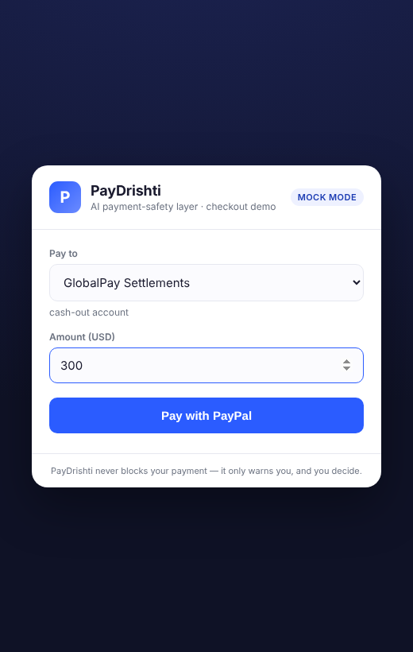
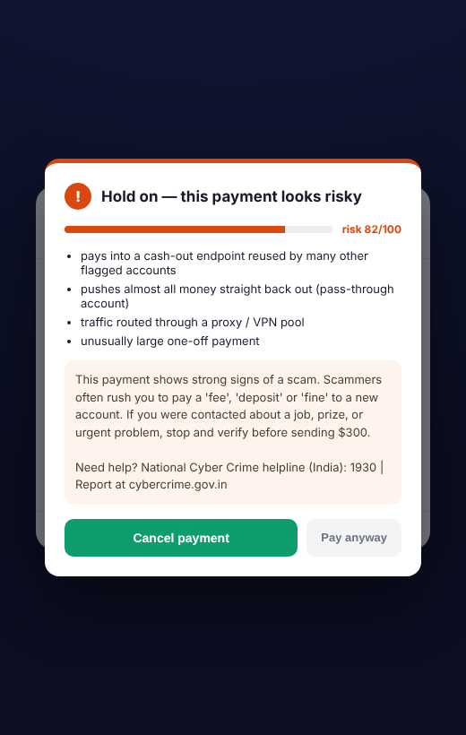
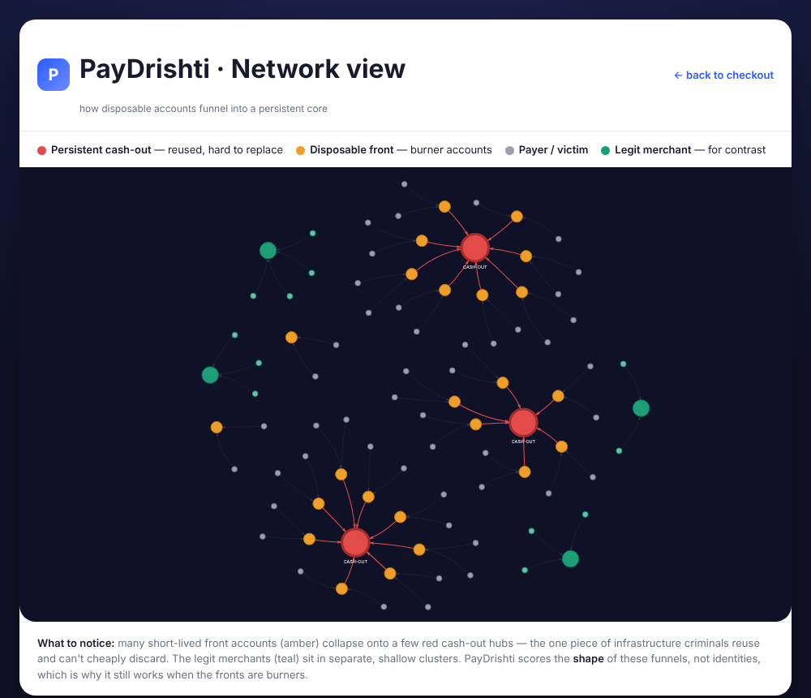

# PayDrishti — AI payment-safety layer for PayPal

**PayPal AI Hackathon 2026 submission — "Build What's Next with PayPal and AI"**

PayDrishti sits inside a PayPal checkout and protects the *payer* at the moment
of payment. When someone is about to send money to an account that shows scam /
trafficking cash-out patterns, PayDrishti scores the payment with AI and shows a
plain-language warning **before** the payment is captured — giving the person a
chance to stop. The money is never auto-blocked; the human always decides.

## See it

| Checkout | AI warning before capture | Fraud network view |
|---|---|---|
|  |  |  |

*Left: a normal checkout. Middle: the AI interstitial that fires on a risky
payee, before the payment is captured. Right: disposable front accounts (amber)
funnelling into the persistent cash-out cores (red) that PayDrishti detects.*

## Why this design

Criminal payment operations churn through disposable front accounts, but they
cannot cheaply replace the thin layer of **reused cash-out accounts** money
funnels into. PayDrishti detects the *shape of the operation* (reused endpoints,
fan-in funnels, pass-through cash-out) rather than trying to identify a person —
so it still works when the fronts are burners and the identities are fake.

The trained model confirms the thesis: its top predictor is `reused_endpoint`,
the permanence signal, not any disposable per-account attribute.

## The two AI surfaces (hackathon "AI" requirement)

1. **Fraud model** — gradient-boosted classifier scoring each payment from the
   payee's behavioural profile (~0.97 ROC-AUC on the synthetic benchmark).
2. **LLM explainer** — turns the risk flags into calm, non-accusing warning copy
   for the payer. Works offline via a template fallback; plug in an API key for
   generated copy.

## PayPal integration (the "PayPal" requirement)

The risk check runs at the chokepoint in PayPal's Orders API flow:
**create order → PayDrishti risk check → (interstitial if high risk) → capture.**
Uses the PayPal sandbox (Orders API v2 + JS SDK buttons + sandbox test accounts).

---

## Setup

```bash
# 1. install
pip install -r requirements.txt

# 2. build the AI engine (no PayPal needed yet)
python backend/synth.py     # generate synthetic data + payee profiles
python backend/model.py      # train + save the model
python backend/run_demo.py   # see the interstitial logic in your terminal
```

### Run the web checkout demo

```bash
cd backend
python app.py          # or: uvicorn app:app --reload --port 8000
```
Open http://localhost:8000 in your browser.

It starts in **MOCK mode** with no PayPal keys needed — you can pick a payee,
hit pay, and see the interstitial fire on risky payees right away.

**Network view:** click "See the fraud network view" on the checkout (or open
`/graph.html`) to see disposable front accounts funnelling into the persistent
cash-out cores — the pattern PayDrishti detects.

### Enable AI-generated warnings (optional, free)

The interstitial text works out of the box (clear templates). To make it
AI-generated, the easiest free path is a local model — no API key, and payment
data never leaves your machine:

```bash
# install Ollama from https://ollama.com, then:
ollama pull llama3.2
ollama serve
```
Set `LLM_PROVIDER=ollama` in `.env`, restart, and test with:
```bash
cd backend && python test_explainer.py
```
(Hosted models also supported: `LLM_PROVIDER=anthropic` or `openai` + `LLM_API_KEY`.)

### Switch to real PayPal sandbox

1. Create a free account at https://developer.paypal.com/
2. Dashboard → Apps & Credentials → **Sandbox** → create an app → copy the
   Client ID and Secret.
3. From the project root: `cp .env.example .env` and paste them into `.env`.
4. Restart the server. The badge flips to **sandbox** and real PayPal buttons
   render. Pay with a sandbox test buyer account; the risk check still gates
   the capture.

> `.env` holds **sandbox** test credentials only. Never commit it or put live
> credentials in it. (`.gitignore` already excludes it.)

---

## Project layout

```
paydrishti/
  backend/
    synth.py         # synthetic world: churning shell + persistent core
    model.py         # train the fraud model
    risk_engine.py   # score a payment -> risk + reasons + interstitial decision
    explainer.py     # risk flags -> payer-facing warning (LLM or template)
    run_demo.py      # CLI demo, no PayPal required
    app.py           # FastAPI server + PayPal Orders API  [next build step]
  frontend/          # checkout page + interstitial UI      [next build step]
  data/              # generated data + trained model (gitignored)
```

## Status

- [x] Synthetic data + AI risk engine + explainer (runs, ~0.97 ROC-AUC)
- [x] PayPal sandbox backend (create/capture + risk gating, with mock fallback)
- [x] Checkout + interstitial web UI
- [x] LLM explainer (template / local Ollama / hosted) with payee context
- [ ] Add your sandbox Client ID to switch mock -> live
- [ ] (optional) enable Ollama for AI-generated warnings
- [ ] Demo video + Devpost write-up
